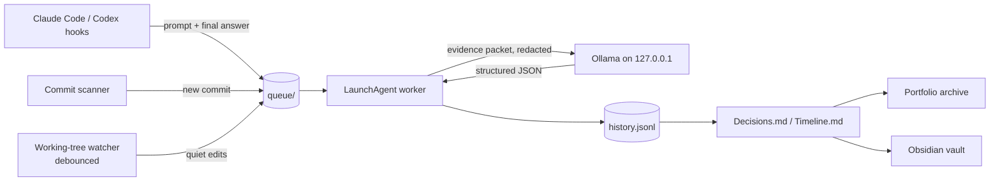

# Decision Watchdog

[](https://github.com/ViliamKratky/decision-watchdog/actions/workflows/ci.yml)
[](LICENSE)


**Remember *why* you built it that way, without writing anything down.**

Decision Watchdog watches your Claude Code and Codex sessions, your commits and
your uncommitted edits, and uses a local Ollama model to keep an evidence-linked
log of the engineering decisions, constraints, dead ends and milestones behind
each project. Nothing leaves your machine.

## Why

The reasoning behind a project is freshest while you are building it and gone
by the time you write the case study, the handover note or the interview
answer. Agent sessions make this worse: the alternatives you weighed and the
bugs you chased live in transcripts nobody reads again. Decision Watchdog
captures that reasoning as it happens and distils it into something a person
can read in five minutes.

## What you get

A `Decisions.md` and a `Timeline.md` per project, regenerated from an
append-only `history.jsonl`. Every entry cites its evidence and carries a
confidence score. Excerpt from [the full example](docs/example/Decisions.md):

```markdown
### Hooks only enqueue; analysis runs in a separate worker

- Date: 2026-09-19T20:12:00+02:00
- Source: claude
- Commit: `8761c50`
- Confidence: 0.93

Agent hooks write a small JSON file to a queue and exit. A LaunchAgent worker
drains the queue and calls the local model.

Alternatives:
- Call Ollama synchronously from the hook

Trade-offs:
- Entries appear minutes after the turn, not instantly
```

## Quick start

```bash
git clone https://github.com/ViliamKratky/decision-watchdog.git
cd decision-watchdog
python3 install.py
decision-watchdog doctor
decision-watchdog register ~/code/my-project
```

Then work as usual. The [setup tutorial](docs/setup.md) walks through every
step, including Ollama, the one-time Codex trust step and troubleshooting.

## How it works



Registration is the only opt-in. Nothing is captured in a repository you have not
registered, and a registered repository is only ever read: no configuration, log,
metadata or `.portfolio/` directory is written inside it, and `git status` is
unchanged. This matters for repositories shared with other contributors.

## What is automatic

- Captures user prompts and completed turns through official hooks.
- Debounces and analyzes events in a background LaunchAgent.
- Detects your new commits in registered repositories, including manual work.
  Checking out an old branch or pulling teammates' commits is not treated as new work.
- Detects uncommitted working-tree changes once editing has gone quiet.
- Writes structured events to a local `history.jsonl` file.
- Rebuilds human-readable `Decisions.md` and `Timeline.md` files.
- Exports distilled evidence to a central SWE portfolio archive when configured.
- Mirrors generated Markdown into an Obsidian vault when configured.
- Removes raw queue archives after the configured retention period.

The hook itself never calls an LLM. It only writes a small queue file, so it stays
inside the short SessionEnd timeout used by Codex and Claude Code. The commit and
working-tree scanners also only write queue files, so a slow local model can never
stall detection.

## Coverage

| Surface | How it is captured |
| --- | --- |
| Claude Code CLI | User-level hooks in `~/.claude/settings.json` |
| Claude Code IDE / desktop | Same hooks - every surface runs the same CLI and reads the same file |
| Codex CLI | User-level hooks in `~/.codex/hooks.json`, **after a one-time trust step** |
| Codex desktop app | Same hooks - the app shares `CODEX_HOME=~/.codex` |
| Manual editing | Commit monitoring, plus debounced working-tree monitoring |

Ordinary ChatGPT and Claude chat sessions are out of scope: they have no local
repository, so there is nothing to attach a decision to. Remote and cloud agents
are out of scope for this release.

### Codex requires a one-time trust step

Codex loads `~/.codex/hooks.json` but silently skips any command hook whose
`trustStatus` is not `trusted`. Until you approve them, Codex sessions are not
captured. Start the Codex TUI, run `/hooks`, review the Decision Watchdog
commands and trust them. `decision-watchdog self-test` asks Codex directly and
reports the real trust status.

## Privacy model

- Ollama is called only on `127.0.0.1:11434`.
- No cloud API is used by this tool.
- Project history and the repository registry live entirely outside the tracked
  repository, under `~/Library/Application Support/Decision Watchdog/`.
- Ollama must be on a loopback address; any other `ollama_url` is refused, and
  HTTP proxy settings are ignored.
- The full agent transcript is not copied or sent to Ollama. The extractor sees the
  current user prompt, final assistant message, Git metadata, and a capped diff.
- Secrets are redacted before anything is queued or sent, credential files
  (`.env*`, keys, `credentials*`, `.npmrc`, `kubeconfig` and similar) are left out
  of diffs entirely, and model output is redacted again before it is stored.
- Repositories are only read, with commands that never rewrite `.git/index`.
- Generated Obsidian notes contain summaries, not raw conversations.

## Installation on macOS

New to the tool? Follow the [setup tutorial](docs/setup.md). In short:

Requirements:

- macOS
- Python 3.10+
- Git
- Ollama running locally with a coding model installed
- Codex CLI and/or Claude Code

Run:

```bash
python3 install.py
```

The installer:

1. copies the app to `~/Library/Application Support/Decision Watchdog/app`,
2. adds a `decision-watchdog` command under `~/.local/bin`,
3. merges hooks into `~/.codex/hooks.json` and `~/.claude/settings.json`,
4. preserves timestamped backups of files it changes,
5. starts a user LaunchAgent.

Codex requires a one-time trust review for newly added hooks. Start Codex, run
`/hooks`, inspect the Decision Watchdog commands, and trust them. Reinstalling
changes the command text, which invalidates the trust, so repeat this step after
every install.

## First checks

```bash
decision-watchdog doctor
decision-watchdog self-test
decision-watchdog status
```

If `~/.local/bin` is not on your PATH, the installer prints the exact line to add.

Configure the central portfolio archive:

```bash
decision-watchdog config --archive "$HOME/Documents/portfolio-archive"
```

Configure an Obsidian vault later:

```bash
decision-watchdog config --vault "/absolute/path/to/Developer OS"
```

Select another installed Ollama model:

```bash
decision-watchdog config --model "your-model:tag"
```

## Daily use

Register each repository you want covered, once. After that no action is required:
work normally in the Claude Code CLI or app, the Codex CLI or app, an IDE, or a
plain terminal.

```bash
decision-watchdog register                     # the repository you are standing in
decision-watchdog register /path/to/repo --name "Client Site"
decision-watchdog register /path/to/repo --slug "client-site"  # archive identifier
decision-watchdog register /path/to/repo --no-watch   # commits only

decision-watchdog projects                     # what is registered
decision-watchdog unregister /path/to/repo     # stop monitoring, keep the history
decision-watchdog unregister /path/to/repo --purge   # also delete the history
```

`register` and `unregister` touch only the external registry. Neither writes
anything into the repository.

Generated files appear in the data directory and, if configured, under:

```text
<vault>/10 Projects/<project name>/
  Decisions.md
  Timeline.md
  Case Study.md        # after generation
```

Useful optional commands:

```bash
# Explicitly preserve an important moment
decision-watchdog mark "Chose a dedicated mobile layout because the desktop diagram became unreadable below 480 px"

# Analyze the current state immediately
decision-watchdog analyze

# Generate/update a case-study draft
decision-watchdog generate

# Show registered projects, archive path and queue state
decision-watchdog status

# Requeue records that failed analysis, without waiting for the backoff
decision-watchdog retry

# Check every capture path end to end
decision-watchdog self-test
```

## Portfolio archive

When `portfolio_archive` is configured, every captured entry is also exported to a
central archive, so portfolio evidence never has to live inside a project
repository:

```text
<archive>/projects/<portfolio-slug>/private/watchdog/
  evidence.jsonl      append-only distilled entries, deduplicated
  Decisions.md        regenerated view
  Timeline.md         regenerated view
  Case Study.md       after `decision-watchdog generate`
  source.json         provenance: project, slug, repository path, remote, counts
```

Each entry carries its own provenance: project name and slug, repository path,
timestamp, commit and branch, changed files, the source that observed it
(`claude`, `codex`, `git`, `worktree`, `manual`), the decision itself, its
context, rationale, alternatives, trade-offs, evidence and a confidence score.

The export writes only inside `private/watchdog/`. A project's curated
`project.yaml`, `case-study.md` and `decisions/` are never created or modified:
turning captured evidence into a polished case study stays a manual step. Whole
repositories are never copied into the archive.

## Avoiding duplicates

One change can be observed three times: by an agent hook, by the working-tree
watcher, and again when it is committed. Three mechanisms keep that to one entry:
each queue record is hashed and analyzed at most once, each extracted entry is
fingerprinted on its normalized type, title and summary, and the archive export
skips any entry id or fingerprint it has already written.

## Reliability

The queue is a directory of small JSON files, and each file moves through three
states: `*.json` (waiting), `*.processing` (claimed by the worker) and, if the
analysis fails, `*.failed`.

- **An Ollama outage pauses the queue.** When Ollama is not running, the
  worker stops after the first record and tries again later, without using up
  any attempts.
- **Other failures are retried.** A record whose analysis fails is retried
  with exponential backoff, from 2 minutes up to 6 hours, for up to 8 attempts.
  `decision-watchdog retry` requeues every failed record at once, including
  those past the limit.
- **Crashes do not strand records.** Only one worker runs at a time, so on
  start it returns every half-finished claim to the queue.
- **Replays are safe.** Each record is hashed and analyzed at most once, and
  state updates are locked, so a retry, a recovered claim or a concurrent
  `mark` can never produce a duplicate entry.
- **Exports are retried separately.** If writing to the archive or vault
  fails, the captured entries are kept and the export is retried later
  without running the model again.

## Working-tree monitoring

Registered repositories are fingerprinted every `worktree_poll_seconds`. A
repository is analyzed only once its fingerprint has stopped moving for
`worktree_debounce_seconds`, so work in progress is never mistaken for a finished
change. `worktree_min_interval_seconds` caps how often one repository can be
analyzed. Committing resets the watcher, because the commit already carries the
change. Set `worktree_watch` to `false` in `config.json` to disable this
globally, or register a project with `--no-watch` to disable it for one
repository.

## Data layout

```text
~/Library/Application Support/Decision Watchdog/
  config.json
  queue/                                   *.json waiting, *.processing, *.failed
  logs/                                    worker-errors.log
  data/projects/<stable-project-id>/       external registry, one per repository
    project.json                           path, portfolio slug, enabled, watch flags
    state.json
    history.jsonl
    Decisions.md
    Timeline.md
    Case Study.md
```

`history.jsonl` is the source of truth. Markdown files are regenerated views.

## Uninstall

```bash
decision-watchdog uninstall
```

The uninstaller removes only the hook handlers installed by Decision Watchdog,
the LaunchAgent, command symlink, and installed application copy. It deliberately
keeps captured project data unless `--remove-data` is supplied.

## Current limitations

- Codex hooks stay inert until they are trusted once inside the Codex TUI. This
  cannot be automated: the trust hash is written by Codex itself.
- `codex exec` (non-interactive) does not dispatch hooks, so scripted Codex runs
  are covered only by commit and working-tree monitoring.
- Nothing at all is captured until a repository is registered with
  `decision-watchdog register`. This is deliberate: hooks fire in every repository
  you open, and only registration opts one in.
- Codex desktop hook support is assumed to match the CLI because both read
  `~/.codex/hooks.json`; `self-test` reports what Codex itself confirms and marks
  the rest as `configured` rather than verified.
- Working-tree monitoring is poll-based, not filesystem-event based, so a change
  is noticed within one poll interval rather than instantly.
- Extracted decisions are model judgments. On the [extraction benchmark](eval/RESULTS.md)
  the default prompt recorded none of 14 negative scenarios and kept all 15 real
  events, but confidence scores are not calibrated and a reason from general
  knowledge occasionally slips in. Review entries before publishing a case study.

## Design decisions

- **Hooks never call a model.** Agents give hooks a few seconds; a local model
  can take minutes. Hooks write a queue file and exit, and a background worker
  does the slow part.
- **Standard library only.** A tool that reads every prompt you type should be
  small enough to audit in an afternoon. There is nothing to `pip install`.
- **Local model, not a cloud API.** Prompts and diffs from client work should
  not leave the machine. The price is weaker extraction than a frontier model,
  which is why every entry carries evidence and a confidence score.
- **Append-only JSONL as the source of truth.** Markdown views are regenerated
  and can be deleted at any time; the history cannot be silently rewritten.
- **Opt-in per repository, zero writes inside it.** Hooks fire everywhere, so
  registration is the only switch, and shared repositories stay untouched.
- **Polling instead of filesystem events.** Debounced polling needs no
  dependencies and treats an edit in progress as unfinished, at the cost of up
  to one poll interval of latency.

## Contributing

Bug reports and pull requests are welcome; see [CONTRIBUTING.md](CONTRIBUTING.md)
and, for anything privacy-related, [SECURITY.md](SECURITY.md). Changes are listed
in [CHANGELOG.md](CHANGELOG.md).

## License

[MIT](LICENSE) © Viliam Kratky
